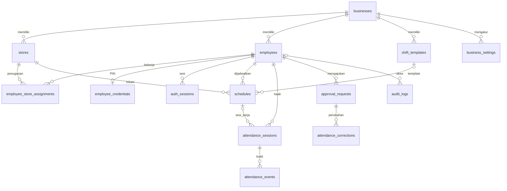

# Database — Fase 2

Database aplikasi tetap PostgreSQL Supabase. PGlite hanya dipakai sebagai mesin PostgreSQL tes in-memory terisolasi, bukan penyimpanan aplikasi. Supabase belum dibuat sesuai jawaban pemilik pada 9 November 2026.

## Migrasi

- `drizzle/0000_initial_attendance.sql`: 14 tabel dari `src/server/db/schema.ts`.
- `drizzle/0001_integrity_and_security.sql`: exclusion constraint jadwal published, satu sesi terbuka, trigger ownership event, audit append-only, keputusan approval final, RLS dan pencabutan akses publik.
- `drizzle/meta`: jurnal dan snapshot Drizzle. Buat migrasi berikutnya dengan `pnpm db:generate`, review SQL sebelum apply. Constraint/trigger SQL khusus harus dipertahankan dalam migrasi berikutnya.

Semua tabel berada di schema privat `attendance`, bukan `public`. Tidak ada akses Data API/browser atau policy publik. Backend nanti wajib memakai role dan otorisasi server yang tepat. RLS aktif tanpa policy berarti koneksi nonprivileged tidak dapat membaca data. Pengujian ini tidak menggantikan verifikasi role runtime Supabase, yang belum tersedia.

## Menjalankan pada database development kosong

Isi `DATABASE_URL` melalui `.env.local` dengan koneksi project khusus development (TLS terverifikasi). Jangan gunakan database berisi data produk lain. Gunakan direct connection, atau session pooler untuk jaringan IPv4. Lalu:

```sh
pnpm db:check
pnpm db:migrate
```

Migrasi tercatat melalui migrator Drizzle dan tidak dijalankan otomatis saat build/deploy. Akun migrasi harus mempunyai izin CREATE EXTENSION btree_gist. Tidak ada operasi reset/drop database.

Untuk data fiktif, pastikan `NODE_ENV` bukan production, `APP_ENV=development`, dan `ALLOW_DEMO_SEED=true` dalam `.env.local`, lalu jalankan `pnpm db:seed:dev`. Setelah selesai kembalikan opt-in ke false. Semua fixture berada pada business dengan `is_demo=true`; seed menolak ID bisnis yang sudah digunakan data non-demo. Seed berjalan dalam transaksi dan idempotent. Tidak ada PIN/token/password dalam seed. Profil owner demo bukan bootstrap akun yang bisa login.

## Repository

`src/server/repositories/workforce.ts` mendefinisikan interface dan implementasi Drizzle untuk membaca karyawan/toko serta mengganti ID tanpa mengubah UUID. Filter business wajib. Repository tidak menyediakan endpoint publik; service auth/RBAC dan CRUD lengkap termasuk audit transaksi dibuat pada fase berikutnya. `src/server/db/client.ts` menjaga koneksi dari import client dan menyediakan close untuk lifecycle tooling.

## Diagram relasi



Event menyimpan employee UUID untuk idempotency dan store UUID untuk bukti lokasi. Trigger mencegah event menunjuk sesi karyawan lain. Target approval memakai target_type/target_id polimorfik; validasi resource/tipe wajib di service Fase 7. Snapshot aturan berupa JSONB disimpan di jadwal dan event; validasi schema setting/snapshot dilakukan pada service fase terkait.

## Bukti tes

`pnpm test`: database baru in-memory; kedua migrasi SQL dijalankan tanpa modifikasi. Delapan tes menguji tabel/RLS, seed dua kali, larangan seed production, repository dan referensi UUID, duplikasi ID, radius, overlap published, shift lintas malam, event duplikat/GPS, audit append-only, dan finalitas approval. Tes ini belum menguji concurrency multi-koneksi PostgreSQL cloud maupun authorization endpoint yang belum dibuat.

## Perubahan Fase 4

Migrasi `0003_owner_management.sql` menambah telepon opsional karyawan, jam operasional toko dan indeks assignment aktif. CRUD/audit/soft status/version settings dijalankan secara transaksional oleh `src/server/owner/service.ts`. Panduan owner, API dan pengujian tersedia di `docs/owner-management.md` dan `docs/api-contract.md`. Tidak ada seed/migrasi yang dijalankan pada cloud.
